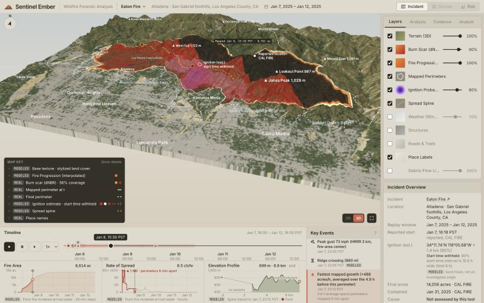

# Sentinel Ember

**A forensic reconstruction of a real wildfire from public records.**
- **When the fire reached each street:** an arrival time for every place that burned.
- **Where and when it started:** a location estimate with a calibrated 90% radius. A start time is shown only when the data pin it to within 6 h; for both fires they don't, so it is withheld.
- **Which homes survived:** outcomes compared at the same exposure.
- **Where debris flows could follow:** post-fire debris-flow likelihood on every stream segment under USGS's design storms, with USGS's model and two models fitted on USGS's observed debris-flow inventory.



Open it at that moment with `?fire=eaton&t=2025-01-08T23:30:00Z`; `&tab=risk` opens the post-fire debris-flow view below ([screenshot](docs/img/eaton-risk.jpg)).

Every number traces back to a public source or a committed evaluation file. The README's headline table below is generated from those files, and a test fails if it drifts.

Built for the **Meta Global AI Developer Hackathon** (2026). The two fires covered are the January 2025 **Eaton** and **Palisades** fires in Los Angeles County.

## Who it's for, and why now

**The user:** the analyst who has to explain a fire afterwards. That includes after-action review teams, county recovery and rebuild planners, insurance and legal investigators, and journalists. Today they rebuild the timeline by hand, from a dozen agency services that don't line up.

**The problem:** a fire's public record is scattered and sparse.
- **Perimeters** are snapshots taken hours apart, and the first one comes late. Eaton's first mapped perimeter is 4.8 h after the reported start; Palisades' is 26 h after.
- **Wind** comes from a few airport stations or a coarse reanalysis.
- **Damage inspections** are a separate table of about 30,000 structures across these two fires.

This project joins them into one timeline, estimates where and when each fire started with checked uncertainty, and compares structure outcomes at equal exposure.

**Why now:** for the January 2025 fires, every input is public and machine-readable:
- NIFC's 2025 operational perimeter archive.
- CAL FIRE's damage inspections (DINS), with construction attributes for each structure.
- NASA JPL's AVIRIS-3 burn-severity flights.
- NOAA's HRRR 3 km weather model, through Open-Meteo's historical archive.

On the model side, Meta's Muse Spark (`muse-spark-1.3`) offers tool calling over an OpenAI-compatible API. The analyst is designed around it: every paragraph must cite a tool result, and its numbers are checked against the cited results before they are shown. It is built and tested offline; it has not yet answered live, which needs a key.

## What works today

| Part | Status | Code |
|---|---|---|
| Data pipeline: 12 steps that turn public data sources into per-fire files, for Eaton and Palisades | **Working.** Outputs are committed in `web/public/data/<fire>/` | [`pipeline/steps/`](pipeline/steps) |
| Arrival time (when each place burned), area and spread-rate series, key events | **Working** | [`s06_arrival.py`](pipeline/steps/s06_arrival.py), [`s10_events.py`](pipeline/steps/s10_events.py) |
| Wind field: HRRR 3 km wind on a grid over each fire, checked against airport stations and ERA5 | **Working** | [`s07_weather.py`](pipeline/steps/s07_weather.py) |
| Ignition back-trace: where and when it started, with calibrated uncertainty and an identifiability rule | **Working and benchmarked** (see Evidence) | [`ember/spread.py`](pipeline/ember/spread.py), [`s11_ignition.py`](pipeline/steps/s11_ignition.py) |
| House-level exposure: destruction odds by construction feature, at matched exposure | **Working** | [`s09b_exposure.py`](pipeline/steps/s09b_exposure.py) |
| Post-fire debris flows (Risk tab): USGS M1 against M1 recalibrated, a random forest and an MLP, scored leaving one fire out on USGS's observed inventory, and mapped on USGS's stream segments | **Working**; compared with USGS's assessment, not validated (no 2025 outcomes) | [`s14_debris_models.py`](pipeline/steps/s14_debris_models.py), [`s15_debris_fire.py`](pipeline/steps/s15_debris_fire.py), [`rail/risk.tsx`](web/src/rail/risk.tsx) |
| Analyst (`muse-spark-1.3`): tool calls over the fire data, with citation, number and guardrail checks on the server, and a chat in the app whose citation chips move the map and the clock | **Built and tested offline. Not yet run against the live API**, which needs `MODEL_API_KEY`; without it the chat shows the server's message, never an answer | [`web/api/`](web/api), [`rail/analyst.tsx`](web/src/rail/analyst.tsx) |
| Web app: replays each fire on 3D terrain from the pipeline's files. The map shows the interpolated progression from `arrival.png`, the burn scar (AVIRIS-3 dNBR, the differenced Normalized Burn Ratio, a standard burn-severity index), the mapped perimeter at the current time, the ignition estimate and its 90% region beside CAL FIRE's reported point, structures, roads and HRRR wind arrows (a layer toggle, off by default). Charts, key events, weather at the current time, the back-trace and house-level analysis, and the source manifest all follow one timeline | **Working** on Eaton and Palisades (switch fires from the header). The Drones and Resources tabs are disabled: there is no data for them in this build | [`web/src/`](web/src) |
| Drone footage: Sentinel YOLOv8 + SAM 3.1 segmentation | **Not started** (stream C). Only the API smoke test exists | [`tools/smoke_meta.py`](pipeline/tools/smoke_meta.py) |
| NASA FIRMS hotspots | **Code done**, gated on `FIRMS_MAP_KEY`; not used in the committed outputs | [`s04_firms.py`](pipeline/steps/s04_firms.py) |

The build is split into three streams ([`WORKSTREAMS.md`](docs/spec/WORKSTREAMS.md)). This branch carries stream A (the data, the forensics and the analyst backend) and the web app's wiring to those outputs.

## How the hard part works

**Arrival time** ([`s06_arrival.py`](pipeline/steps/s06_arrival.py)). Timed NIFC perimeters are cleaned:
- Re-saves are dropped.
- Placeholder triangles from the incident-reporting system are removed.
- Cumulative footprints are clipped to the final perimeter.

Each cell's arrival is then interpolated by distance between consecutive footprints. The first interval is seeded from CAL FIRE's reported start time and location. For Eaton the reported point lies outside the first mapped perimeter, so the seed is that perimeter's nearest cell, 1.7 km away (`arrival_meta.json` records this). For Palisades, whose first map is 26 h in, that seeded interval covers about half the burned area. Times are observed only at the perimeter times, so the layer is labelled MODELED.

**Wind field** ([`s07_weather.py`](pipeline/steps/s07_weather.py)). HRRR is sampled hourly on a grid of points about 3 km apart over each fire area: 4×6 for Eaton, 5×7 for Palisades. Each model is compared with the nearest airport station at the station's own location: HRRR, ERA5 and ECMWF IFS. HRRR tracks hourly wind and humidity better than ERA5 at both stations, which is why it drives the spread model. `wind_field.json` is published for the app.

**Spread model** ([`ember/spread.py`](pipeline/ember/spread.py)):
- **Rate of spread:** elliptical, from a per-fuel base rate (ESA WorldCover classes) times a power-law wind term and a tan²-slope term.
- **Fire shape:** Anderson's length-to-breadth ratio, up to a cap.
- **Arrival:** a time-dependent Dijkstra over a 16-neighbour stencil. Wind is interpolated bilinearly per cell from the HRRR grid, and in time to 15 minutes. The stencil never cuts across non-burnable corners.
- **Speed:** compiled with numba and run in parallel.

**Inversion** ([`s11_ignition.py`](pipeline/steps/s11_ignition.py)). The search runs over (ignition cell, start time, spread-rate scale k):
- **Candidates:**
  - Cells on a lattice inside the first observed footprint.
  - Up to 16 start times, log-spaced from 0.5 h to 90 h before that footprint, and never before the weather record begins.
  - 17 values of k, from 0.25 to 64. Refinement can go 20% past the top, to 76.8; a fit that ends there is reported as at the ceiling.
- **Scoring:** each candidate is simulated forward and scored against every observed footprint with a weighted hinge loss. Cells inside a footprint should have burned by then; a band outside it should not have. Earlier footprints weigh more.
- **Refinement:** a second stage refines the best eight candidates.
- **Fire shape per fit:** the ellipse's length-to-breadth cap is chosen per fit, from 1 to 8, by loss on the real perimeters. With realistic winds, Anderson's curve makes the model fire far narrower than these fires were (spotting and gusts that swing direction widen a real fire), and the cap is how the fit corrects for that. Eaton's fit picks 1, a round fire, so wind no longer sets its shape; Palisades picks 1.5. The hold-out chooses its own cap without the held-out perimeters.

**Calibrated uncertainty and the identifiability rule.** The relative likelihood over the stage-1 grid gives a posterior heatmap, a 90% radius and a 90% start-time interval. That grid is regular (lattice cells × log-spaced lags × log-spaced k), so the implied prior is uniform over the lattice and log-uniform over lag and k; each lattice cell's weight is spread over the cells nearest it. Stage 2 only sharpens the point estimate: counting its dense neighbourhoods would weight cells by how often they were evaluated.
- **Not hand-tuned:** the temperature is calibrated on each fire's own synthetic fires. Half the cases pick it; coverage is reported on the other half. Where no temperature tried reaches 90% on the calibration half, the widest is used, the fit is flagged uncalibrated in the outputs, the app and the analyst, and its start time is withheld.
- **Matched to the fit it serves:** the hold-out and the product fit use different observations, so each gets its own calibration. Both calibrations invert with the product fit's shape cap; the hold-out picks its own cap, which matches for Eaton (1) but not for Palisades (8 vs 1.5).
- **When the start time is withheld:** if the interval is wider than 6 h, k sits at the model's ceiling, or the uncertainty is uncalibrated. The timeline then omits the estimated start and the analyst declines to give one.
- **Inputs to the rule:** it looks only at the fit, never at CAL FIRE's reference. The synthetic benchmark does borrow the real fire's observation delays, measured from CAL FIRE's reported start.

**Synthetic benchmark.** Each synthetic fire runs on the fire's real terrain, fuels and HRRR wind field, and is observed on its real perimeter schedule. The truth differs from the inverting model in kind, not just in parameters:
- per-fuel rates ±25–30%;
- a smooth, patchy fuel field the model never sees;
- wind speed ±15%, direction ±15° and timing ±1.5 h;
- a perturbed length-to-breadth cap;
- ±1-cell mapping noise.

The spread-rate range is centred on the fuel table itself: k log-uniform 0.25–4, i.e. its base rates off by up to 4× either way. It has not always been: commit `0eab9dc` drew k from 4–16 to resemble the real Eaton fit of the time (k ≈ 11), and `66e8516` moved it to 0.25–4 when the HRRR fit brought Eaton's k to 0.42. Other design choices (the shape cap, the start-time lags) were also diagnosed on the real Eaton grid, so the real Eaton hold-out is a sanity check rather than an independent test. The real Palisades fits (k 22.6 in the hold-out, 76.8 at the ceiling in the full fit) lie outside the synthetic range, so Palisades' synthetic coverage describes slower fires than the real one. Each case is inverted twice: on every footprint, as the app does, and with the first two held out, as in the real hold-out. `make eval QUICK=1` recomputes the first cases and checks that they match the committed ones exactly.

**House-level exposure** ([`s09b_exposure.py`](pipeline/steps/s09b_exposure.py)). Each residence within about 100 m of the burn gets three exposure values:
- **Arrival time.** Homes just outside the burned cells take the nearest burned cell's time, and are flagged.
- **HRRR gust** at that place and hour.
- **Distance to wildland:** tree, shrub or grass cover where under 20% of a 500 m window is built up.

The analysis on top:
- **Odds ratios:** each construction feature gets a Mantel–Haenszel odds ratio of destruction, stratified by gust × distance, with a Robins–Breslow–Greenland confidence interval.
- **Regression:** a logistic regression fits all features together.
- **Observability check:** the share of "unknown" answers among destroyed versus surviving homes, because inspectors record a destroyed home's features after the fire.

**Analyst** ([`web/api/_lib/`](web/api/_lib)):
- **Tools:** Muse Spark gets 9 read-only tools over the fire files (place lookup, arrival at a point, street burn times, fire state at a time, weather, structures, events, the ignition back-trace, exposure statistics) plus a `final_answer` call.
- **Checks before a paragraph is returned** ([`verify.ts`](web/api/_lib/verify.ts)):
  - It must cite a tool result from the same conversation.
  - Every number and clock time in it must appear in the cited tool results or in the question. Rounding is allowed; computed numbers are not. Small whole numbers up to 10 are exempt.
  - It must not match the cause, attribution or address patterns.
- **What happens to failures:** dropped paragraphs are counted by reason.
- **Eval** ([`scripts/eval-analyst.ts`](web/scripts/eval-analyst.ts)): 15 questions per fire, with ground truth computed from the data files by code independent of the tools. Questions with no truth in the data are skipped and listed, so 14 are scored for Eaton and 13 for Palisades. Where the back-trace withholds a start time, the ignition question becomes a must-decline question.

## Evidence

The table is generated by `make report` from the committed eval files. The full tables, with p90s, baselines and every contrast, are in [`docs/RESULTS.md`](docs/RESULTS.md).

<!-- headline:start (generated by make report; do not edit) -->
| | Eaton Fire | Palisades Fire |
|---|---|---|
| Synthetic fires, location error (median): back-trace vs first-footprint centroid | 588 m vs 449 m | 526 m vs 1,624 m |
| Synthetic fires, start-time error (median): back-trace vs √area back-extrapolation | 78 min vs 21.6 h | 4.6 h vs 37.0 h |
| The same with the first two perimeters held out: location; start time | 924 m vs 1,406 m; 3.1 h vs 52.2 h | 786 m vs 1,744 m; 16.4 h vs 109.7 h |
| 90% radius / interval contains the truth, on synthetic cases the calibration never saw | 87% / 93% (radius 1,717 m, interval 10.31 h) | 100% / 100% (radius 1,681 m, interval 43.25 h) |
| Unseen synthetic cases where the app would show a start time | 0 of 15 | 0 of 15 |
| Real fire: estimated start time | withheld (not identifiable) | withheld (not identifiable) |
| Real hold-out: start-time error vs CAL FIRE (baseline) | 2.3 h (-30.9 h); withheld as not identifiable | 40.0 h (-707.9 h); the estimate is later than the held-out perimeters, so not a credible start, and withheld as not identifiable |
| CAL FIRE's reported point, distance outside the first mapped footprint | 1,772 m | 0 m |
| Real fit with the HRRR wind field vs the old single ERA5 point (footprint IoU, spread-rate scale k) | IoU 0.45, k 0.424 vs IoU 0.30, k 11.314 | IoU 0.38, k 76.8 vs IoU 0.40, k 76.8 (ceiling) |
| Hourly wind vs the nearest airport station: HRRR vs ERA5 | r 0.90 vs 0.71 | r 0.85 vs 0.75 |
| Odds ratio of destruction, fine-mesh vents vs coarse (95% CI) | 0.35 (0.31–0.40) | 0.50 (0.45–0.56) |
| Odds ratio, tile/metal/concrete roof vs asphalt/wood | 0.59 (0.53–0.66) | 0.58 (0.53–0.64) |
<!-- headline:end -->

How to read it:
- **Synthetic rows** test recovery when the truth is known and the physics deliberately differs from the model.
- **Coverage row:** whether the stated 90% uncertainty holds on cases the calibration never saw.
- **"Would show a start time" row:** how often the identifiability rule lets a start time through, and how good it is when it does.
- **Real-fire rows** compare against CAL FIRE's *reported* start. That is a reported time and incident location, not an investigated origin.
  - For Eaton, the reported point lies outside the first four mapped perimeters (up to 10:37Z): 1,721 m outside the 07:06Z polygon (1,772 m on the analysis grid, as in the table) and 1,108 m outside the 10:34Z one. The search is confined to the first fitted footprint, so it can't reach that point: the early perimeters missed the origin area, or the point is approximate.
- **IoU** (intersection over union) compares the modeled and observed burned areas: 1 means identical, 0 means no overlap.
- **Wind row:** the current fit against the pipeline before HRRR (one ERA5 point, shape cap 8), so it mixes the wind change with the shape-cap change. [`eval/wind_ablation.json`](web/public/data/eaton/eval/wind_ablation.json) separates them, and `RESULTS.md` lists all four variants.
- **Odds ratios** are associations, adjusted only for the recorded exposure.

What it shows:
- **Start time is where the back-trace beats the baseline.** On synthetic fires its start time is closer than √area back-extrapolation in 93% (Eaton) and 83% (Palisades) of cases.
- **Location is mixed.** For Eaton the first footprint's centroid is closer on the median (449 m vs 588 m; the back-trace wins 57% of cases). With the shape cap at 1 the model fire is round, and a round fire's first footprint is centred near its start, so the centroid is a strong guess. The back-trace wins when the early perimeters are held out (924 m vs 1,406 m), and for Palisades, whose first map comes 26 h in.
- **No start time is shown yet.** Under the 6 h rule, no unseen synthetic case (in either scenario) and neither real fit gets one: the honest intervals are 10–13 h wide for Eaton and 43–64 h for Palisades. Eaton's real hold-out interval (23:15Z on Jan 7 to 09:52Z on Jan 8, 10.6 h) does hold CAL FIRE's 02:18Z, and its estimate is 2.3 h late. An earlier posterior that also counted the dense second-stage candidates gave Eaton's hold-out a 5.9 h interval that let the time through and missed CAL FIRE's start; that is why the posterior now comes from the regular grid alone.
- **Coverage is close to, not always at, 90%.** On unseen synthetic cases the 90% radius held the true origin in 87% of Eaton's full-fit cases (13 of 15) and 93% of its hold-out cases; the start interval held the true start in 87–100%.
- **HRRR helps Eaton, not Palisades.** For Eaton at the same shape cap, the HRRR field lowers the fit loss (2.16 → 2.02 h) and raises the mean footprint IoU (0.41 → 0.45) over the ERA5 point. Most of the gain over the old pipeline (IoU 0.30) comes from the shape cap, though, and one uniform HRRR wind matches the field (IoU 0.46). For Palisades every wind variant leaves k at the ceiling: the model can't grow that fire fast enough under any of them.

## Post-fire debris flows

Burned, steep slopes can shed debris flows in the first winters' storms. The Risk tab shows USGS's stream segments for each fire (956 for Eaton, 1,864 for Palisades) with the chance of a debris flow under USGS's seven design storms (peak 15-minute rainfall 16–40 mm/h), from three models:
- **USGS M1 (published):** USGS's own hazard assessments for these fires (Staley et al. 2017 coefficients; [doi:10.5066/P14EWYME](https://doi.org/10.5066/P14EWYME), CC0). Our implementation reproduces its likelihoods to within 4×10⁻¹⁶, which checks our code, not the model.
- **M1 recalibrated:** the same form refitted on USGS's observed debris-flow inventory ([Graber et al. 2026](https://doi.org/10.5066/P1R9VXC4): 7,639 usable watershed-storm records from 77 fires, 2000–2024, 955 of them debris flows).
- **Random forest:** fitted on that inventory with M1's inputs plus watershed area, days since the fire and antecedent soil moisture (ERA5-Land via Open-Meteo), and constrained never to fall as rainfall rises.

Each trained model is scored on fires it never saw (leave one fire out, [`debris_flow/model_eval.json`](web/public/data/debris_flow/model_eval.json)):

| Model | ROC AUC, all records | ROC AUC within one fire and storm (median) | Station Fire (2009), held out |
|---|---|---|---|
| USGS M1, published (scored on the 6,319 records it was not fitted on) | 0.881 | 0.809 | n/a (fitted on it) |
| M1 recalibrated | 0.828 | 0.750 | 0.825 |
| Random forest, monotone in rainfall | 0.815 | 0.800 | 0.704 |
| MLP (evaluated, not mapped) | 0.841 | 0.808 | 0.746 |
| MLP plus neighbouring watersheds (evaluated, not mapped) | 0.848 | 0.750 | 0.776 |

What it shows:
- **Machine learning did not beat USGS's M1 where it matters.** A design-storm map ranks watersheds within one storm. There, on the records M1 was not fitted on, the random forest and MLP score 0.825 and 0.813 (median) against M1's 0.809, and 0.783 and 0.798 (record-weighted) against 0.797. The groups are small (median 10 records), and we report no intervals, so we don't rank the models.
- **USGS's published likelihoods run high on newer records.** On the 6,319 records M1 was not fitted on they average 0.363, while 9.8% of those storms produced a debris flow. M1 recalibrated keeps USGS's ranking of segments (Spearman 0.88 for Eaton, 0.94 for Palisades) at a much lower level (at 24 mm/h, mean 0.16 against USGS's 0.71 on Eaton). That level follows how each sub-inventory sampled storms without a debris flow (25% of the Staley et al. 2016 records are flows against 10% of the rest), so read absolute levels with caution.
- **Neighbouring watersheds did not help.** Adding the inputs of the five nearest watersheds raised the MLP's pooled ROC AUC by 0.007 but lowered its within-storm median by 0.058, so no map column uses them.
- **The random forest's level depends on a scenario:** 2025-02-13, 37 days after ignition and the first day after the fire with at least 25.4 mm (1 inch) of rain at the fire in ERA5, with one soil-moisture value per fire. Only 950 inventory records come from storms that soon after a fire, 857 of them from one Thomas Fire storm, so its level is an extrapolation.
- **Nothing here is validated for 2025.** The inventory has no Eaton or Palisades outcomes, so the maps are compared with USGS's assessment. The Station Fire, 13 km from Eaton and held out from fitting, is the nearest past test (M1 was designed on data that include it); Palisades has no such fire, since the inventory's Santa Monica Mountains fires (Topanga 2005, Canyon 2007) recorded no debris flows.

## Limitations

- **Model physics.**
  - No spotting, crown fire or suppression.
  - Wind structure below HRRR's 3 km is missed.
  - The length-to-breadth cap is a stand-in for spotting and gusts that swing direction, fitted per fire, not a mechanism.
- **Weather is a model.** HRRR is a model analysis and short-range forecast, not observations. Its station agreement is in `weather_station.json`.
- **Reference point.** CAL FIRE's start is a reported incident location, not an investigated origin. Distance to it is a sanity check, not ground truth. The project never states or guesses a cause.
- **Palisades is beyond the model.** Under every wind tried, k sits at the ceiling: without spotting, the model can't spread that fire as fast as it burned. That alone withholds its start time.
- **Calibration scope.** Coverage is measured under the benchmark's perturbations, which are probably smaller than real model errors.
- **What the benchmark does not test.** Synthetic origins lay inside the first footprint the search covers in 100% of Eaton cases and 97–100% of Palisades cases (a fire grown from its origin almost always contains it). For Eaton, CAL FIRE's reported point lies 1.7 km outside the first mapped perimeter, a case the benchmark never exercises.
- **Thin calibration samples.** Calibration rests on 15 unseen cases per scenario.
- **House-level results are associations.** They are not effects of the features.
  - Destroyed homes have far more "unknown" answers, so features that burn away are recorded unevenly.
  - Some contrasts run opposite to building-code expectations, and some don't replicate across the two fires (see `RESULTS.md`). We report them as they are.
- **Burn severity coverage.** AVIRIS-3 dNBR covers about half of Eaton's perimeter and only a sliver of Palisades (`severity_stats.json`).
- **Not yet verified:**
  - The analyst has not been run live against the Meta API.
  - The drone footage stream has not started.
  - The web app has been checked in desktop Chromium only; it needs WebGL2.

## Reproduce

Requires Python 3.11+ with [uv](https://docs.astral.sh/uv/), and Node 20.19+ (`web/.nvmrc`; `npm ci` refuses older Node). After a one-time package download (`uv sync`, `npm ci`), everything below runs offline against the committed outputs, except `make debris`: it downloads USGS's inventory and assessments and 256 ERA5-Land soil-moisture series on its first run, and step 15 needs the model file step 14 writes (`pipeline/work/debris_flow/models.joblib`, not committed). With those cached, the two steps take under 2 minutes.

```bash
cd pipeline && uv sync
make test                                        # pipeline tests on the Eaton and Palisades outputs, incl. README headline drift
make eval EVAL_DIR=/tmp/ember-eval               # re-run the real Eaton hold-out; matches eval/ignition_holdout.json (5-15 min)
make eval QUICK=1 EVAL_DIR=/tmp/ember-eval-quick # recompute 2 synthetic cases and check them against the committed ones (about 8 min)
make report                                      # regenerate docs/RESULTS.md and the README headline table
make debris                                      # debris-flow models and maps (needs network: ScienceBase, Open-Meteo)

cd ../web && npm ci
npm test                                         # analyst tests (no key needed)
npm run build                                    # typecheck app + API, production build
npm run eval:analyst -- --truth --fire palisades # print an analyst eval's ground truth (no key needed)
npm run dev                                      # the app at http://localhost:5173 (?fire=palisades); no key needed
```

With network access, `make all` rebuilds every output from the public sources (`make FIRE=palisades all` for Palisades). `make eval-full` reruns the whole synthetic benchmark and the wind ablation: about 70 min for Eaton and 100 min for Palisades on a 10-core laptop ([`docs/reproduction/`](docs/reproduction)).

With a Meta key in `.env` (`cp .env.example .env`):
- `npm run ask -- "When did the fire reach Lake Avenue?"` asks the analyst one question.
- `npm run eval:analyst` scores it.
- `npm run dev` also answers in the app's Analyst tab (`POST /api/analyst`).

## Meta models

| Model | Role | Status |
|---|---|---|
| `muse-spark-1.3` (Meta Model API, OpenAI-compatible) | The analyst: a tool-calling loop over the reconstructed fire. Citations and numbers are verified server-side, and an independent per-fire eval includes must-decline questions | Built and tested offline; live run pending a key |
| `sam-3.1` (Meta Model API, Responses API) | Fire and smoke masks in drone video; destroyed-building masks in post-fire imagery | Smoke test only ([`tools/smoke_meta.py`](pipeline/tools/smoke_meta.py)); stream C |

## Prior work and credits

- **Sentinel** ([`benjaminxie1/sentinel-app`](https://github.com/benjaminxie1/sentinel-app)) is a team member's earlier open-source fire/smoke detector. Its trained YOLOv8 model is planned as a dependency for stream C. Everything else is built during the hackathon.
- **Design inspiration:** the layout and interaction model are inspired by Dilum Sanjaya's "FireTrace" wildfire-analysis concept, shared on X. Its name and logo are not used.
- **Data:** every source, with its licence note and status (REAL, MODELED or SIM), is in each fire's `manifest.json` and the app's Evidence tab. Source details are in [`docs/spec/BUILD.md`](docs/spec/BUILD.md) §5.

## Docs

- [`docs/RESULTS.md`](docs/RESULTS.md): every evaluation number, generated from the committed outputs
- [`docs/spec/BUILD.md`](docs/spec/BUILD.md): architecture, data pipeline, models, evaluation plan, schedule
- [`docs/spec/DESIGN.md`](docs/spec/DESIGN.md): UI specification
- [`docs/spec/WORKSTREAMS.md`](docs/spec/WORKSTREAMS.md): the three workstreams and their file and API contracts
- [`docs/judge/RUBRIC.md`](docs/judge/RUBRIC.md) and [`judge-round.js`](docs/judge/judge-round.js): the fixed rubric and the harness this repo is judged with each round; [`rounds/`](docs/judge/rounds) holds each round's raw results
