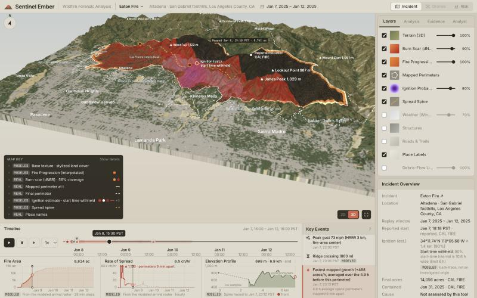

# Sentinel Ember

**Live wildfire intelligence from AI-piloted drones, for quicker wildfire suppression.**

Firefighters work from data that comes hours late. In the Palisades Fire, the first public fire map came 26 hours after it started, when about half the fire had already burned. Fly a drone over the fire, and Sentinel Ember tells firefighters two things: **where the fire is right now**, and **where it will be in an hour**.

- **Where the fire is now:** connect a drone feed (or any camera or video stream). Our fine-tuned YOLOv8 fire detector runs at the edge, in the browser on the ground-station laptop with ONNX and WebAssembly, boxing flames in under a fifth of a second per frame. Meta's SAM 3.1 then traces each fire's outline from the one-word prompt "fire". Given the drone's pose (a DJI SRT track or one typed in), each detection lands on a 3D digital twin of the fire: the real hills, with the real wind.
- **Where it will be in an hour:** a Muse Spark forecaster reads the fire's edge, the wind and the slope, and draws where the front will be in an hour.
- **AI-piloted drones:** a Muse Spark commander and three squad agents assign six simulated drones waypoints to watch that advancing edge. We test their decisions in a Gymnasium reinforcement-learning environment powered by MuJoCo, on the real Eaton Fire terrain, with thrust, wind drag, battery, camera coverage and line of sight.

All of it sits on a reconstruction of the January 2025 **Eaton** and **Palisades** fires from public records:
- **When the fire reached each place:** hover the map for the arrival time of any burned cell, interpolated between mapped perimeters and labelled MODELED. Burn times along a whole street come from the analyst's street-timeline tool, which needs a Meta key (`MODEL_API_KEY`).
- **Where and when it started:** a location estimate with a calibrated 90% radius. A start time is shown only when the data pin it to within 6 h; for both fires they don't, so it is withheld.
- **Which homes survived:** outcomes compared at the same exposure.
- **Where debris flows could follow:** post-fire debris-flow likelihood on every stream segment under USGS's design storms, with USGS's model and two models fitted on USGS's observed debris-flow inventory.

[What runs live, what is cached and what is simulated](#live-replayed-and-simulated) says which is which.



Run it (Node 20.19+, no key needed):

```bash
cd web && npm ci && npm run dev
```

Then open http://localhost:5173/?fire=eaton&t=2025-01-08T23:30:00Z for this view; `&tab=risk` opens the post-fire debris-flow view ([screenshot](docs/img/eaton-risk.jpg)), and `?fire=palisades` switches fires.

A one-minute tour, one stop per point above:
1. **Arrival:** drag the timeline at the bottom. The progression, the mapped perimeter, the charts and the key events follow it; hover any point for when it burned.
2. **Start:** the right-hand rail's Analysis tab shows the back-trace, its 90% region beside CAL FIRE's reported point, and why the start time is withheld.
3. **Homes:** under Analysis, Homes compares destruction odds by construction feature at matched exposure. Turn on Structures under Layers and click one to see its inspection outcome; addresses and parcels are never shown.
4. **Debris flows:** the header's Risk tab colours each stream segment by likelihood; pick the model and the design storm.
5. **Sources and questions:** the rail's Evidence tab lists every source as real, modeled or simulated. The Analyst tab (needs `MODEL_API_KEY`) answers questions such as "When did the fire reach Lake Avenue?"; its citation chips move the map and the clock.
6. **Palisades:** switch fires in the header. The same views load; its back-trace sits at the spread-rate ceiling, so its start is withheld too.
7. **Drones:** the header's Drones tab plays two public-domain BLM wildfire clips (Oregon, not Eaton) with the fire detector's boxes and SAM 3.1's outlines. Its Live mode runs the detector on your camera, a shared screen or a video URL (another site's video must be served with CORS headers), with no key; SAM 3.1 outlines on live frames need `MODEL_API_KEY` on the server.
8. **Forecast and swarm (Eaton):** turn on Spread Forecast (+1 h) under Layers, and open the Incident rail's Swarm tab for the simulated drone swarm and its agent graph.

Every number traces back to a public source or a committed evaluation file. The README's headline table below is generated from those files, and a test fails if it drifts.

Built for the **Meta Global AI Developer Hackathon** (2026). The two fires covered are the January 2025 **Eaton** and **Palisades** fires in Los Angeles County.

## Who it's for, and why now

**The user:** incident teams who need to know where the front is now and where it is heading, and the analysts who have to explain a fire afterwards. The analysts include after-action review teams, county recovery and rebuild planners, insurance and legal investigators, and journalists. Today they rebuild the timeline by hand, from a dozen agency services that don't line up.

**The problem:** a fire's public record is scattered and sparse.
- **Perimeters** are snapshots taken hours apart, and the first one comes late. Eaton's first mapped perimeter is 4.8 h after the reported start; Palisades' is 26 h after.
- **Wind** comes from a few airport stations or a coarse reanalysis.
- **Damage inspections** are a separate table of about 30,000 structures across these two fires.

This project joins them into one timeline, estimates where and when each fire started with checked uncertainty, and compares structure outcomes at equal exposure.

**Why now:** the burn scars face their first winters now, and the evidence to reconstruct these fires only recently became public in machine-readable form:
- USGS's observed post-fire debris-flow inventory for the western US was published in 2026 (Graber et al.), and USGS's debris-flow hazard assessments for Eaton and Palisades in 2025. Together they let the Risk tab test models against observed outcomes and against USGS's own assessment.
- NIFC's 2025 operational perimeter archive keeps each fire's timed perimeters.
- CAL FIRE's damage inspections (DINS) give construction attributes for every inspected structure.
- NASA JPL's AVIRIS-3 flew burn-severity imagery over these fires.
- NOAA's HRRR 3 km weather model is in Open-Meteo's historical archive.

The analyst runs on Meta's Muse Spark (`muse-spark-1.3`), whose tool calling lets every paragraph cite a tool result. It has been run live on both fires (see the Analyst row below).

## Live, replayed and simulated

| Feature | What happens when you use it |
|---|---|
| Analyst (`muse-spark-1.3`) | **Live.** Each question calls Muse Spark at request time through `POST /api/analyst`, behind a spend cap and rate limits. Needs `MODEL_API_KEY` on the server. |
| Fire detector, Drones → Live | **Live.** The fine-tuned model runs in the browser (onnxruntime-web, WASM) on the newest camera, screen or stream frame; the HUD shows inference time, frame rate and latency measured on your device. Benchmarked at 154 ms median, 172 ms p90 per 1280×720 frame (letterbox, inference and NMS) on one WASM thread in headless Chrome on a 4-vCPU 2.1 GHz cloud container ([`detector-latency.json`](web/bench/detector-latency.json), `npm run bench:detector`); not yet measured on a laptop. A video file played this way is labelled as such, not as live drone footage. |
| SAM 3.1 outlines, Drones → Live | **Live** on camera, screen and URL feeds: while the detector has a box, a frame goes to `POST /api/sam` at most every 2 s and SAM 3.1 is called on the Meta Model API (daily spend cap). Without a server key it says so and draws nothing. |
| Live hits on the 3D map | **Live** projection of each detection onto the terrain from a DJI SRT track or a pose you type in. Tested only with synthetic and typed-in poses; no real flight log exists for the bundled clips. |
| Bundled drone clips (detector boxes, SAM 3.1 outlines) | **Cached.** The detector's boxes and SAM 3.1's masks were computed once by pipeline steps 12 and 12c (SAM through the real API) and committed; playing a clip makes no model call. |
| +1 h spread forecast (Muse Spark and physics) | **Cached.** Muse Spark made every forecast live in one run (67 calls, $1.57); the app shows the committed polygons and makes no model call. Made in hindsight and labelled FORECAST. |
| Drone swarm (Swarm tab) | **Simulated, then replayed.** A MuJoCo simulation over the Eaton Fire: real terrain, the reconstructed spread and HRRR wind, but no drones flew this fire. Muse Spark's commander and squad decisions were live tool calls during the run; the app replays the committed logs. Labelled SIM. |
| Reconstruction (arrival, back-trace, homes, debris flows) | **Precomputed** by the pipeline from public records and committed; arrival times between perimeters are interpolated and labelled MODELED. |

## What works today

| Part | Status | Code |
|---|---|---|
| Data pipeline: 12 steps from public sources to per-fire files | **Working**; outputs committed in `web/public/data/<fire>/` | [`pipeline/steps/`](pipeline/steps) |
| [Arrival time](docs/METHODS.md#arrival-time), area and spread-rate series, key events | **Working** | [`s06_arrival.py`](pipeline/steps/s06_arrival.py), [`s10_events.py`](pipeline/steps/s10_events.py) |
| [Wind field](docs/METHODS.md#wind-field): HRRR 3 km grid, checked against stations and ERA5 | **Working** | [`s07_weather.py`](pipeline/steps/s07_weather.py) |
| [Ignition back-trace](docs/METHODS.md#inversion) with [calibrated uncertainty](docs/METHODS.md#calibrated-uncertainty-and-the-identifiability-rule) | **Working and benchmarked** ([Evidence](#evidence)) | [`ember/spread.py`](pipeline/ember/spread.py), [`s11_ignition.py`](pipeline/steps/s11_ignition.py) |
| [House-level exposure](docs/METHODS.md#house-level-exposure): destruction odds at matched exposure | **Working** | [`s09b_exposure.py`](pipeline/steps/s09b_exposure.py) |
| [Post-fire debris flows](#post-fire-debris-flows) (Risk tab): USGS's M1 against models fitted on USGS's inventory | **Working**; compared with USGS's assessment, not validated | [`s14_debris_models.py`](pipeline/steps/s14_debris_models.py), [`s15_debris_fire.py`](pipeline/steps/s15_debris_fire.py), [`rail/risk.tsx`](web/src/rail/risk.tsx) |
| [Analyst](docs/METHODS.md#analyst) (`muse-spark-1.3`): checked tool calls over the fire data | **Working; runs live**: 33 of 33 eval answers right on the live rerun after the street-tool fix (2026-11-03) | [`web/api/`](web/api), [`rail/analyst.tsx`](web/src/rail/analyst.tsx) |
| [Web app](docs/METHODS.md#web-app): replays each fire on 3D terrain, on one timeline | **Working** on both fires, with the Drones tab | [`web/src/`](web/src) |
| Drone footage: fine-tuned YOLOv8 fire detector + SAM 3.1 segmentation | **Working, live in the browser**: the detector runs on camera, screen or stream input; SAM 3.1 outlines on live frames through `/api/sam`. Never run on a real live drone feed. Frame-level eval on DeepQuest: detector P 0.73 / R 0.64, SAM 3.1 P 1.00 / R 0.945 | [`drones/live/`](web/src/drones/live), [`api/sam.ts`](web/api/sam.ts), [`s12c_sam_video.py`](pipeline/steps/s12c_sam_video.py) |
| Live hits and fire edge on the 3D map | **Working** with a DJI SRT track or a typed-in pose; tested only on synthetic poses | [`livemap.ts`](web/src/drones/live/livemap.ts), [`dronegeo.ts`](web/src/lib/dronegeo.ts) |
| [+1 h spread forecast](docs/FORECAST.md) (Eaton): physics and Muse Spark | **Working**, made in hindsight; Muse forecasts cached from a live run. Neither beats carrying the recent rate forward | [`sim/forecast.py`](pipeline/sim/forecast.py), [`stage/forecast-layer.ts`](web/src/stage/forecast-layer.ts) |
| [Drone swarm](docs/SWARM.md) (Eaton): MuJoCo simulation, Muse Spark commander and squads | **Working as a simulation** (SIM: no drones flew this fire); runs replayed in the Swarm tab | [`pipeline/sim/`](pipeline/sim), [`rail/swarm.tsx`](web/src/rail/swarm.tsx) |
| NASA FIRMS hotspots | **Code done**, gated on `FIRMS_MAP_KEY`; not used in the outputs | [`s04_firms.py`](pipeline/steps/s04_firms.py) |

How each part works is in [`docs/METHODS.md`](docs/METHODS.md).

The build is split into three parts that teammates work on in parallel ([`WORKSTREAMS.md`](docs/spec/WORKSTREAMS.md)): data and forensics, the web app, and drone footage. All three, plus the forecast and the swarm simulation, are merged on this branch.

## Evidence

The table is generated by `make report` from the committed eval files. The full tables, with p90s, baselines and every contrast, are in [`docs/RESULTS.md`](docs/RESULTS.md).

<!-- headline:start (generated by make report; do not edit) -->
| | Eaton Fire | Palisades Fire |
|---|---|---|
| Synthetic fires, location error (median): back-trace vs first-footprint centroid | 588 m vs 449 m | 526 m vs 1,624 m |
| Synthetic fires, start-time error (median): back-trace vs √area back-extrapolation | 78 min vs 21.6 h | 4.6 h vs 37.0 h |
| The same with the first two perimeters held out: location; start time | 924 m vs 1,406 m; 3.1 h vs 52.2 h | 786 m vs 1,744 m; 16.4 h vs 109.7 h |
| 90% radius / interval contains the truth, on synthetic cases the calibration never saw (95% CI) | 87% (62–96%) / 93% (70–99%); radius 1,717 m, interval 10.31 h | 100% (80–100%) / 100% (80–100%); radius 1,681 m, interval 43.25 h; the real fit's k (76.8) lies above every synthetic truth (max 3.6) |
| Unseen synthetic cases where the app would show a start time | 0 of 15 | 0 of 15 |
| Real fire: estimated start time | withheld (not identifiable) | withheld (not identifiable) |
| Real hold-out: distance to CAL FIRE's reported point (baseline: first-footprint centroid) | 2,504 m (2,460 m) | 315 m (3,557 m); the hold-out fit predicts neither held-out perimeter, so this is not a result |
| Real hold-out: start-time error vs CAL FIRE (baseline) | 2.3 h (-30.9 h); withheld as not identifiable | 40.0 h (-707.9 h); the estimate is later than the held-out perimeters, so not a credible start, and withheld as not identifiable |
| CAL FIRE's reported point, distance outside the first mapped footprint | 1,772 m | 0 m |
| Real fit with the HRRR wind field vs the old single ERA5 point (footprint IoU, spread-rate scale k) | IoU 0.45, k 0.424 vs IoU 0.30, k 11.314 | IoU 0.38, k 76.8 (ceiling) vs IoU 0.40, k 76.8 (ceiling) |
| Hourly wind vs the nearest airport station: HRRR vs ERA5 | r 0.90 vs 0.71 | r 0.85 vs 0.75 |
| Odds ratio of destruction, fine-mesh vents vs coarse (95% CI) | 0.35 (0.31–0.40) | 0.50 (0.45–0.56) |
| Odds ratio, tile/metal/concrete roof vs asphalt/wood | 0.59 (0.53–0.66) | 0.58 (0.53–0.64) |
| Analyst live on `muse-spark-1.3`: answers matching the data-derived truth; cited ids a tool returned | 17/17; 23/23 | 16/16; 20/20 |
<!-- headline:end -->

How to read it:
- **Synthetic rows** test recovery when the truth is known and the physics deliberately differs from the model ([how the benchmark works](docs/METHODS.md#synthetic-benchmark)).
- **Coverage row:** whether the stated 90% uncertainty holds on cases the calibration never saw. Each share is followed by its 95% Wilson interval, since it rests on 15 unseen cases.
- **"Would show a start time" row:** how often the identifiability rule lets a start time through, and how good it is when it does.
- **Real-fire rows** compare against CAL FIRE's *reported* start. That is a reported time and incident location, not an investigated origin.
  - For Eaton, the reported point lies outside the first four mapped perimeters (up to 10:37Z): 1,721 m outside the 07:06Z polygon and 1,108 m outside the 10:34Z one (vector distances, computed in `RESULTS.md`; 1,772 m and 1,142 m on the analysis grid, as in the table and `ignition.json`). The search is confined to the first fitted footprint, so it can't reach that point: the early perimeters missed the origin area, or the point is approximate.
- **IoU** (intersection over union) compares the modeled and observed burned areas: 1 means identical, 0 means no overlap.
- **Wind row:** the current fit against the pipeline before HRRR (one ERA5 point, shape cap 8), so it mixes the wind change with the shape-cap change. [`eval/wind_ablation.json`](web/public/data/eaton/eval/wind_ablation.json) separates them, and `RESULTS.md` lists all four variants.
- **Odds ratios** are associations, adjusted only for the recorded exposure.

What it shows:
- **Start time is where the back-trace beats the baseline.** On synthetic fires its start time is closer than √area back-extrapolation in 93% (Eaton) and 83% (Palisades) of cases.
- **Location is mixed.** For Eaton the first footprint's centroid is closer on the median (449 m vs 588 m; the back-trace wins 57% of cases). With the shape cap at 1 the model fire is round, and a round fire's first footprint is centred near its start, so the centroid is a strong guess. The back-trace wins when the early perimeters are held out (924 m vs 1,406 m), and for Palisades, whose first map comes 26 h in.
- **No start time is shown yet.** Under the 6 h rule, no unseen synthetic case (in either scenario) and neither real fit gets one: Eaton's intervals are 10–13 h wide (real fits and synthetic cases). Palisades' synthetic and hold-out intervals are 43–64 h; its full fit's 7.5 h interval is withheld because k sits at the model's ceiling. The Palisades hold-out's temperature (38.4 h) is the top of the grid tried, so its 100% coverage says little. Eaton's real hold-out interval (23:15Z on Jan 7 to 09:52Z on Jan 8, 10.6 h) does hold CAL FIRE's 02:18Z, and its estimate is 2.3 h late. An earlier posterior that also counted the dense second-stage candidates gave Eaton's hold-out a 5.9 h interval that let the time through and missed CAL FIRE's start; that is why the posterior now comes from the regular grid alone.
- **Coverage is close to, not always at, 90%.** On unseen synthetic cases the 90% radius held the true origin in 87% of Eaton's full-fit cases (13 of 15) and 93% of its hold-out cases; the start interval held the true start in 87–100%. Palisades' full fit covered 100% of both, with wide intervals (median 43 h), so it sits above the target rather than at it.
- **HRRR helps Eaton, not Palisades.** For Eaton at the same shape cap, the HRRR field lowers the fit loss (2.16 → 2.02 h) and raises the mean footprint IoU (0.41 → 0.45) over the ERA5 point. Most of the gain over the old pipeline (IoU 0.30) comes from the shape cap, though, and one uniform HRRR wind matches the field (IoU 0.46). For Palisades every wind variant leaves k at the ceiling: the model can't grow that fire fast enough under any of them.

## Post-fire debris flows

Burned, steep slopes can shed debris flows in the first winters' storms. The Risk tab shows USGS's stream segments for each fire (956 for Eaton, 1,864 for Palisades) with the chance of a debris flow under USGS's seven design storms (peak 15-minute rainfall 16–40 mm/h), from three models:
- **USGS M1 (published):** USGS's own hazard assessments for these fires (Staley et al. 2017 coefficients; [doi:10.5066/P14EWYME](https://doi.org/10.5066/P14EWYME), CC0). Our implementation reproduces its likelihoods to within 5×10⁻¹⁶ (largest difference 4.4×10⁻¹⁶), which checks our code, not the model.
- **M1 recalibrated:** the same form refitted on USGS's observed debris-flow inventory ([Graber et al. 2026](https://doi.org/10.5066/P1R9VXC4): 7,639 usable watershed-storm records from 77 fires, 2000–2024, 955 of them debris flows).
- **Random forest:** fitted on that inventory with M1's inputs plus watershed area, days since the fire and antecedent soil moisture (ERA5-Land via Open-Meteo), and constrained never to fall as rainfall rises.

Each trained model is scored on fires it never saw (leave one fire out, [`debris_flow/model_eval.json`](web/public/data/debris_flow/model_eval.json)). The within-storm column covers 99 fire-storm groups for the trained models and the 64 outside M1's training data for M1; `model_eval.json` also scores every model on M1's 64 for a like-for-like comparison:

| Model | ROC AUC, all records | ROC AUC within one fire and storm (median, 95% interval) | Station Fire (2009), held out |
|---|---|---|---|
| USGS M1, published (scored on the 6,319 records it was not fitted on) | 0.881 | 0.809 [0.700, 0.932] (64 storms) | n/a (fitted on it) |
| M1 recalibrated | 0.828 | 0.750 [0.667, 0.800] | 0.825 |
| Random forest, monotone in rainfall | 0.815 | 0.800 [0.688, 0.864] | 0.704 |
| MLP (evaluated, not mapped) | 0.841 | 0.808 [0.700, 0.850] | 0.746 |
| MLP plus neighbouring watersheds (evaluated, not mapped) | 0.848 | 0.750 [0.656, 0.864] | 0.776 |

What it shows:
- **Machine learning did not clearly beat USGS's M1 where it matters.** A design-storm map ranks watersheds within one storm. On the records M1 was not fitted on, with 95% intervals from a bootstrap over fire-storm groups, the extended random forest's within-storm median ROC AUC minus M1's is +0.015 [−0.063, +0.097] and the extended MLP's is +0.004 [−0.104, +0.101]. Every interval includes zero, and those for the models on M1's four inputs alone lean below it. One Thomas Fire storm holds about half of those records, so the record-weighted figures lean on it. The Risk tab shows each model's interval.
- **USGS's published likelihoods run high on newer records.** On the 6,319 records M1 was not fitted on they average 0.363, while 9.8% of those watershed-storm records had a debris flow. M1 recalibrated keeps USGS's ranking of segments (Spearman 0.88 for Eaton, 0.94 for Palisades; the mapped random forest agrees far less, 0.38–0.47 and 0.63–0.82 across the design storms) at a much lower level (at 24 mm/h, mean 0.16 against USGS's 0.71 on Eaton). That level follows how each sub-inventory sampled storms without a debris flow (25% of the Staley et al. 2016 records are flows against 10% of the rest), so read absolute levels with caution.
- **Neighbouring watersheds did not help.** Adding the inputs of the five nearest watersheds raised the MLP's pooled ROC AUC by 0.007 but lowered its within-storm median by 0.058, so no map column uses them.
- **The random forest's level depends on a scenario:** 2025-02-13, 37 days after ignition and the first day after the fire with at least 25.4 mm (1 inch) of rain at the fire in ERA5, with one soil-moisture value per fire. Only 950 inventory records come from storms that soon after a fire, 857 of them from one Thomas Fire storm, so its level is an extrapolation.
- **Nothing here is validated for 2025.** The inventory has no Eaton or Palisades outcomes, so the maps are compared with USGS's assessment. The Station Fire, 13 km from Eaton and held out from fitting, is the nearest past test (M1 was designed on data that include it); Palisades has no such fire, since the inventory's Santa Monica Mountains fires (Topanga 2005, Canyon 2007) recorded no debris flows.

## Limitations

- **Model physics.**
  - No spotting, crown fire or suppression.
  - Wind structure below HRRR's 3 km is missed.
  - The length-to-breadth cap is a stand-in for spotting and gusts that swing direction, fitted per fire, not a mechanism.
- **Weather is a model.** HRRR is a model analysis and short-range forecast, not observations. Its station agreement is in `weather_station.json`.
- **Reference point.** CAL FIRE's start is a reported incident location, not an investigated origin. Distance to it is a sanity check, not ground truth. The project never states or guesses a cause.
- **Palisades is beyond the model.** Under every wind tried, k sits at the ceiling: without spotting, the model can't spread that fire as fast as it burned. That alone withholds its start time. A simple deterministic spotting edge did not fix it either: with embers landing 0.5–2 km downwind whenever HRRR wind reached 15–25 mph, k stayed at the ceiling in all six settings tried and the fit's loss barely moved ([`experiments/spotting.py`](pipeline/experiments/spotting.py), results in `spotting_palisades.json`). So the gap is not just missing ember jumps; we did not ship that term.
- **Calibration scope.** Coverage is measured under the benchmark's perturbations, which are probably smaller than real model errors.
- **What the benchmark does not test.** Synthetic origins lay inside the first footprint the search covers in 100% of Eaton cases and 97–100% of Palisades cases (a fire grown from its origin almost always contains it). For Eaton, CAL FIRE's reported point lies 1.7 km outside the first mapped perimeter, a case the benchmark never exercises.
- **Thin calibration samples.** Calibration rests on 15 unseen cases per scenario. The headline table gives each coverage share a 95% interval.
- **House-level results are associations.** They are not effects of the features.
  - Destroyed homes have far more "unknown" answers, so features that burn away are recorded unevenly.
  - Some contrasts run opposite to building-code expectations, and some don't replicate across the two fires (see `RESULTS.md`). We report them as they are.
- **Burn severity coverage.** AVIRIS-3 dNBR covers about half of Eaton's perimeter and only a sliver of Palisades (`severity_stats.json`).
- **Not yet verified:**
  - The live analyst eval is one run per fire, 33 scored questions in all.
  - Live drone detection has run on cameras, screens and video streams, never on a real live drone feed, and the map placement has never run on a real flight. The detector misses smoke-only frames (smoke recall 0 on DeepQuest).
  - The bundled drone clips are Oregon BLM footage, not Eaton.
  - The forecast and the swarm cover Eaton only, and the swarm is a simulation.
  - The web app has been checked in desktop Chromium only; it needs WebGL2.

## Reproduce

Requires Python 3.11+ with [uv](https://docs.astral.sh/uv/), and Node 20.19+ (`web/.nvmrc`; `npm ci` refuses older Node). After a one-time package download (`uv sync`, `npm ci`), everything below runs offline against the committed outputs, except `make debris`: it downloads USGS's inventory and assessments and 256 ERA5-Land soil-moisture series on its first run, and step 15 needs the model file step 14 writes (`pipeline/work/debris_flow/models.joblib`, not committed). With those cached, the two steps take under 2 minutes.

```bash
cd pipeline && uv sync
make test                                        # pipeline tests on the Eaton and Palisades outputs, incl. README headline drift
make eval EVAL_DIR=/tmp/ember-eval               # re-run both real hold-outs, into /tmp/ember-eval-eaton and -palisades; each matches its eval/ignition_holdout.json (Eaton 5-15 min, Palisades about 12 min)
make eval FIRE=palisades EVAL_DIR=/tmp/ember-eval-pal  # one fire only, written to EVAL_DIR as given
make eval QUICK=1 EVAL_DIR=/tmp/ember-eval-quick # recompute 2 synthetic cases per fire and check them against the committed ones (about 8 min per fire)
make report                                      # regenerate docs/RESULTS.md and the README headline table
make debris                                      # debris-flow models and maps (needs network: ScienceBase, Open-Meteo)

cd ../web && npm ci
npm test                                         # analyst tests (no key needed)
npm run build                                    # typecheck app + API, production build
npm run eval:analyst -- --truth --fire palisades # print an analyst eval's ground truth (no key needed)
npm run dev                                      # the app at http://localhost:5173 (?fire=palisades); no key needed
```

With network access, `make all` rebuilds every output from the public sources (`make FIRE=palisades all` for Palisades). `make eval-full` reruns the whole synthetic benchmark and the wind ablation: about 70 min for Eaton and 100 min for Palisades on a 10-core laptop ([`docs/reproduction/`](docs/reproduction)).

With a Meta key in `.env` (`cp .env.example .env`):
- `npm run ask -- "When did the fire reach Lake Avenue?"` asks the analyst one question.
- `npm run eval:analyst` scores it.
- `npm run dev` also answers in the app's Analyst tab (`POST /api/analyst`).

## Meta models

| Model | Role | Status |
|---|---|---|
| `muse-spark-1.3` (Meta Model API, OpenAI-compatible) | The analyst: a tool-calling loop over the reconstructed fire. Citations and numbers are verified server-side, and an independent per-fire eval includes must-decline questions | Runs live in the app. Live eval rerun (2026-11-03): 17 of 17 Eaton and 16 of 16 Palisades answers right, all 43 cited ids from a tool result ([`RESULTS.md`](docs/RESULTS.md#analyst-eval)) |
| `muse-spark-1.3` | The +1 h spread forecaster (`forecast_spread` tool call per sector) and the swarm's commander and squad agents | Run live on Eaton; outputs committed and replayed. Forecaster: 67 calls, 23 replies rejected and scored as no growth ([`FORECAST.md`](docs/FORECAST.md)). Swarm: 3 seeds each of commander + squads and commander + rule, plus one forecaster + swarm run (198 calls) that hit its $3.50 cap at 09:45Z of the 12 h window ([`SWARM.md`](docs/SWARM.md)) |
| `sam-3.1` (Meta Model API, Responses API) | Fire outlines (text prompt "fire", or the detector's boxes as prompts) on drone video, live and on the bundled clips; the DeepQuest image eval also prompted "smoke" | Live in the Drones tab's Live mode through [`api/sam.ts`](web/api/sam.ts). Bundled-clip masks come from [`s12c_sam_video.py`](pipeline/steps/s12c_sam_video.py), cached. Image eval on DeepQuest: P 1.00 / R 0.945 ([`eval/sam_video.json`](web/public/data/eaton/eval/sam_video.json)). Destroyed-building masks ([`s09c_sam_structures.py`](pipeline/steps/s09c_sam_structures.py)) are not built |

## Prior work and credits

- **Prior work:** before the hackathon, Ben built [Sentinel](https://github.com/benjaminxie1/sentinel-app), an open-source fire detection app. We started from its YOLOv8 model file, which turned out to have no fire class.
- **Built at the hackathon:** everything else. That includes training the fire detector on FireNET ([`sentinel_fire.pt`](pipeline/models/sentinel_fire.pt)), running it in the browser, the SAM 3.1 outlines, the 3D map, the forecaster, the drone swarm and its simulation, the analyst and the data pipeline.
- **Design inspiration:** the layout and interaction model are inspired by Dilum Sanjaya's "FireTrace" wildfire-analysis concept, shared on X. Its name and logo are not used.
- **Data:** every source, with its licence note and status (REAL, MODELED or SIM), is in each fire's `manifest.json` and the app's Evidence tab. Source details are in [`docs/spec/BUILD.md`](docs/spec/BUILD.md) §5.

## Docs

- [`docs/METHODS.md`](docs/METHODS.md): how the hard part works: arrival time, wind field, spread model, back-trace and its calibration, synthetic benchmark, house-level exposure, analyst and web app
- [`docs/RESULTS.md`](docs/RESULTS.md): every evaluation number, generated from the committed outputs
- [`docs/FORECAST.md`](docs/FORECAST.md): the +1 h spread forecaster and how it is scored
- [`docs/SWARM.md`](docs/SWARM.md): the drone-swarm simulation (SIM) and its results
- [`docs/spec/BUILD.md`](docs/spec/BUILD.md): architecture, data pipeline, models, evaluation plan, schedule
- [`docs/spec/DESIGN.md`](docs/spec/DESIGN.md): UI specification
- [`docs/spec/WORKSTREAMS.md`](docs/spec/WORKSTREAMS.md): the three workstreams and their file and API contracts
- [`docs/judge/RUBRIC.md`](docs/judge/RUBRIC.md) and [`judge-round.js`](docs/judge/judge-round.js): the fixed rubric and the harness this repo is judged with each round; [`rounds/`](docs/judge/rounds) holds each round's raw results
